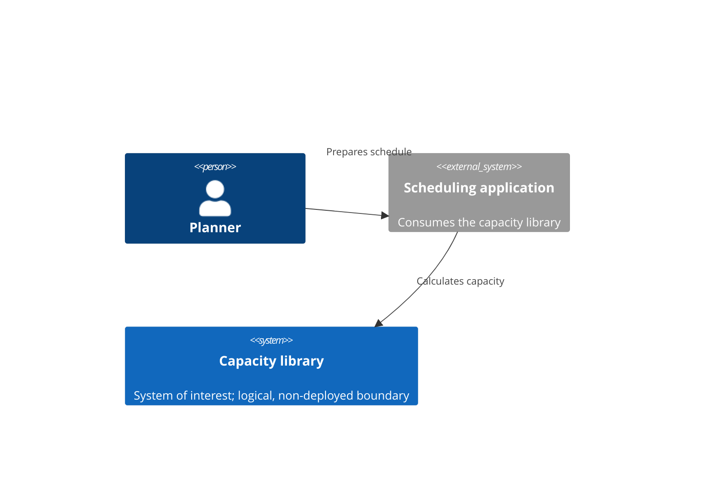

# Architecture and decomposition

Start with the required outcomes, domain responsibilities and material constraints. Use
aggregates, invariants and business capabilities as candidate boundaries, then test them
against technical coupling, consistency, failure isolation, security and change needs.
Domain boundaries inform components; they do not automatically require separate services.
Use established context relationships and their meaning, decision-ownership and information
constraints when assessing technical boundaries. Return missing semantic decisions to define-change.
A domain context map describes relationships between domain meanings. The C4 system-context view
below describes a system and its external interactions; neither substitutes for the other.
Distinguish the system of interest, logical responsibility boundaries, runtime processes,
storage ownership and deployment units. Explain which boundaries coincide and why. A logical
component need not have its own process, host or store. Existing scaffolding or persistent data
establishes present implementation, not a requirement for the target deployment.

For recovery, use the shared [purpose and maintenance guidance](../../../shared/artifacts.md#purpose-and-maintenance)
to describe the inspected architecture without making it a target contract. Separate substantial
current and target architectures during migration, with their purposes and relationship explicit.
Keep file catalogues, function signatures and commands in implementation references unless a
detail explains an architectural choice. Architecture describes context, responsibilities,
boundaries, interfaces, dependencies and material technology roles.

## System context

Every document classified as architecture that you create or revise must have a "System context"
section near the beginning, with an embedded editable diagram and a brief statement of its scope.
Classify artifacts by their purpose and repository conventions. This does not require an architecture
document for every change or migration of unrelated existing documents. A link alone does not satisfy
the requirement; reuse an authoritative view by including its relevant diagram and citing its source.

Use a C4 system context view. Identify the system of interest, people or roles, consuming applications
and relevant external systems. Label interactions with their purpose and direction. Show evidenced
paths: when an operator uses an application that calls a library, show operator to application to
library, not an unsupported direct operator-to-library relationship. For a library, label its logical
boundary without implying a separately deployed service. Keep internal components and deployment
details out of this view; put any needed decomposition elsewhere in the document.

Distinguish current, proposed and unresolved relationships with labels or a clear legend. Do not
invent interactions to complete the picture. Use the [models guidance](models.md) for notation,
fallback conditions and validation. Check the context against the document's
boundaries, responsibilities and interfaces, then trace one representative usage path through both.
Report unsupported or conflicting relationships rather than silently settling them in the diagram.
Apply the [connector-layout checks](models.md#keep-connectors-traceable) to the rendered context
view. Revise avoidable box intersections, overlapping connectors and crossings before completion;
preserve every material relationship and report any unresolved visual-check limitation.

For example, this context covers the capacity library and its current callers. The library's
boundary is logical; it is not a separately deployed service.

For an as-built context, support current relationships with inspected implementation and state
its evidence limits. For a target context, distinguish governing commitments from explicitly
proposed relationships.

## Responsibilities and decomposition

Name each necessary component's responsibility, owned information and decisions, provided
and required interfaces, and dependency direction. Explain cross-boundary workflows and
trust crossings. Identify what already exists, what changes and what remains an assumption.
Do not infer missing contracts from boxes and arrows or specify all internal designs upfront.

When proposing or materially reconsidering a consequential boundary, compare credible alternatives
before settling the split.
Trace the same representative workflow through each, including inputs, completion, retained
state and recovery after interruption or partial failure. Include material operating work,
such as configuration, credentials, deployment, monitoring and restoration, where it affects
that workflow. Compare the total burden within components, between components and during
recovery. Fewer boxes or shorter local code alone does not establish a simpler solution.
Check whether interfaces provide complete useful operations or make callers coordinate another
component's internal steps. Explain which burden moves rather than implying that it disappears.
Use as many alternatives and components as the decision needs, without a fixed count.

Justify independent hosting through evidenced isolation, access, resource, availability or
change needs. Storage-oriented components and multiple consumers can be appropriate. Judge
the responsibilities, contracts and operational consequences rather than rejecting those
shapes. Separate a justified deployment constraint from an optional logical decomposition.

Cite any requirements, domain meanings and accepted ADR commitments that govern these
boundaries. Architecture explains their structural consequences; it need not catalogue every
implementing design or test. New downstream documents alone do not change the architecture.

A scoped design should fit the accepted component map. A change to private modules or interfaces
within the same accepted architectural responsibility does not by itself require an architectural
revision or separate assessment. Assess proposed changes to accepted responsibility or interface
ownership, permitted dependencies, public behavior, compatibility, security obligations or governing
verification requirements in the owning architecture or technical contract, even when the changed
code is private. Architectural changes still require checking consistency of the system context view.
Reuse already accepted changes without reopening acceptance; verify that implementation satisfies
them. An explicitly requested design or architecture review still receives its requested assessment.

A new interface specified by the design needs its provider, consumers, contract and relevant
failure behavior; implementation signatures can follow later.

When decomposition is requested, favor independently valuable and verifiable increments.
Respect authority and correctness first, then a coherent usable outcome, then independence.
Keep an increment within architecture/domain boundaries where that avoids needless coupling.
A necessary cross-boundary end-to-end slice is better than isolated components that deliver
nothing. State the prerequisite contract or genuine dependency instead of claiming parallelism
from different filenames. Shared state, migration order and integration proof matter.
The execution lead owns scheduling and detailed work packages, not this reference.

## Technology authority

Inspect repository ADR policy and precedent before calling a dependency an implementation
detail. Policy determines granularity. Otherwise a main technology is a selected runtime,
framework, storage/processing engine, acquisition/browser tool, parser, validation system or
build/deployment tool that supplies a material capability or operating constraint. Include
consequential production fallbacks. Test-only tools, transitive dependencies, incidental
helpers, unadopted experiments and routine upgrades do not automatically require ADRs.

For each new or materially changed main technology role, connect technology and role to
affected scope and the applicable ADR/status. Keep this in the design or working evidence
only when relevant, not a central registry. Search ADRs by name, capability, role and scope.
Accepted coverage can govern repeated use within the same role and scope. Independently
replaceable material roles require their own decision coverage; a new role is not covered
merely because the package name matches. A version is a decision only if its constraints are.

Missing or proposed required ADR coverage blocks the affected implementation, not continued
proposal work. An accepted design cannot substitute for a required accepted ADR. Report
conflicts and excluded scopes instead of settling them in design prose.

Distinguish adoption evidence from rationale. “Not adopted” means the inspected production
scope does not use it; “rejected” needs a recorded decision; “replaced” needs a successor in
the same role; “abandoned” needs evidence work stopped; “experimental” means limited to that
scope. Absence alone does not prove rejection. Do not require exact versions in ADRs unless
architecturally relevant. Implementation drift is checked by the execution lead at handoff.
